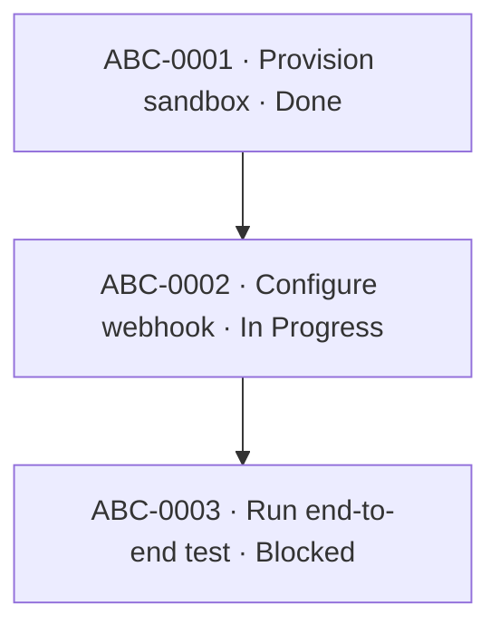

# Mermaid Policy

Mermaid is a derived visualization layer. Keep canonical facts in frontmatter/Markdown and explain diagrams in adjacent prose.

## Selection matrix

| Question | Use |
|---|---|
| What depends on what? What path can execution take? | `flowchart` |
| Who talks to whom, in what order? | `sequenceDiagram` |
| How does an object change state? | `stateDiagram-v2` |
| What are the static object/type relationships? | `classDiagram` |
| What is the relational/cardinality data model? | `erDiagram` |
| What happened over chronological milestones? | `timeline` |
| What is scheduled against real dates/durations? | `gantt` |
| What happened across Git branches/commits? | `gitGraph` |
| What is an exploratory concept hierarchy? | `mindmap` |

## Project dependency graph

Project notes always carry a task dependency/progress `flowchart`, rendered top-to-bottom (`flowchart TD`).

- One node per material Task.
- `A --> B` means B is blocked by A.
- Label each node with the Task identifier, title, and status, e.g. `ABC-0123 · Authenticated HTTP/SSE server · Backlog`.
- Never invent edges from mere preferred order.
- Over ~25-30 Tasks, keep the Project diagram focused on current milestone and move the full graph to a `Diagram` note.

Example:

Text next to the diagram must state that Task frontmatter is authoritative.
