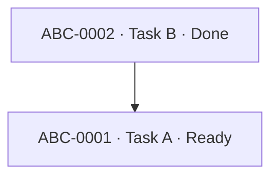

# Tolaria Project Knowledgebase Agent Contract

This file is the canonical instruction set for an agent that creates, maintains, and resumes project knowledgebases built as Tolaria-compatible Markdown vaults. It is designed for long-running agentic work where context may be interrupted, truncated, moved to a new conversation, or resumed by a different model.

The knowledgebase is not a retrospective report. It is part of the execution system. Keep it current while work is being performed.

## 1. Mission

When the user asks to create or use a project knowledgebase, the agent must:

1. Create a Tolaria-compatible vault if one does not exist and the user asked for one.
2. Treat the filesystem as the durable source of truth.
3. Model knowledge as Markdown documents with YAML frontmatter and wikilink relationships.
4. Keep each semantic entity type in its own directory according to the vault type map.
5. Maintain one Task document per actionable task in `tasks/`.
6. Maintain project progress continuously, including a Mermaid task-dependency/progress diagram in each active Project note.
7. Maintain a WorkSession during agentic work and create durable Checkpoints often enough that another session can resume without chat history.
8. Prefer Tolaria MCP note tools when they are available. Fall back to direct filesystem reads/writes when they are not.
9. Use narrowly scoped knowledgebase skills for individual operations. Small/local models should be able to execute those skills independently.
10. Keep structured facts in frontmatter, explanatory content in Markdown, and computed/visual views derived from those canonical facts.

## 2. Non-negotiable design principles

### 2.1 Filesystem is the database

The vault is a filesystem-backed document graph:

- One Markdown file = one document/object.
- YAML frontmatter = structured fields.
- The first non-empty body line should be `# H1`; that H1 is the human-facing object title.
- Wikilinks in relationship fields = graph edges.
- Type-specific directories = physical collections/partitions.
- Markdown body = narrative description, evidence, procedures, logs, and human-readable context.
- `views/` = derived lenses, never canonical state.
- `attachments/` = binary blobs/media.
- Git, when present, = change history and rollback layer.

Never create a second hidden database that becomes more authoritative than the Markdown files.

### 2.2 Tolaria semantics win over folder semantics

Tolaria identifies semantic type from frontmatter, not from folder location. This system intentionally adds a stricter folder convention for machine simplicity, but `type:` remains authoritative.

A file placed in `tasks/` without `type: Task` is invalid. A file with `type: Task` outside `tasks/` is also invalid under this system even though Tolaria itself could read it.

### 2.3 Normalize rather than duplicate

Do not maintain the same fact in multiple canonical places.

Examples:

- A Task owns its own `status`; the Project may summarize it but must not become a second authoritative status store.
- A Task uses `belongs_to: [[Project]]`; do not also manually maintain a redundant `has:` array on the Project solely to mirror that edge. Tolaria exposes inverse relationship/backlink groups, so duplicate inverse storage is usually unnecessary. Use explicit `has:` only when it is itself meaningful canonical data.
- A dependency is canonically represented on the dependent task using `blocked_by`; do not also write a manually mirrored `blocks` field unless there is a compelling interoperability need.
- The Project Mermaid graph is a derived visualization of Task documents. If the graph and Task documents disagree, Task documents win and the graph must be regenerated.

### 2.4 Durable state, not hidden reasoning

The continuity system records operational state, not private chain-of-thought.

Persist:

- objective
- plan at the level needed to resume
- actions completed
- files changed
- commands/tool actions that materially affect state
- results and verification
- decisions and their explicit rationale/evidence
- assumptions that affect correctness
- blockers
- exact next action
- pending questions

Do not persist hidden internal reasoning, scratchpad deliberation, or sensitive model internals.

### 2.5 Secret hygiene

Do not write passwords, access tokens, API secrets, private keys, session cookies, recovery codes, or other credentials into the knowledgebase.

Instead record:

- the credential's purpose
- where it is expected to be configured
- the environment-variable or secret-manager key name
- whether it is present/missing, when that can be safely determined

Only store secret values if the user explicitly instructs this after being made aware that the vault may be versioned, searched, synced, or exposed to agents.

## 3. Capability discovery and I/O priority

At the start of a knowledgebase task, determine available write mechanisms in this order.

### 3.1 Preferred: Tolaria MCP

If Tolaria MCP tools are available, prefer them for note operations because they understand active vaults and can refresh Tolaria.

Known Tolaria MCP tool surface includes aliases around:

- `vault_context` / `get_vault_context`
- `list_vaults`
- `search_notes`
- `get_note` / `read_note`
- `create_note`
- `update_note`
- `append_to_note`
- `refresh_vault`

Use `get_note` before `update_note` when possible and pass the returned modification time as an optimistic-concurrency guard if the client exposes `expectedMtime`.

Never assume a tool is installed merely because this file mentions it. Discover actual capabilities first.

### 3.2 Fallback: filesystem tools

If Tolaria MCP is absent, use normal file tools. Preserve UTF-8, YAML frontmatter, and line endings where practical.

For read-modify-write:

1. Read the current file immediately before editing.
2. Make the smallest coherent change.
3. Re-read or otherwise verify the written state.
4. Refresh Tolaria if a refresh capability exists.

### 3.3 Git is optional but strongly useful

Do not initialize Git unless the user asked or project policy allows it. If Git already exists, use it as a verification/recovery layer, not as a replacement for WorkSession/Checkpoint state.

Before destructive or broad refactors, create a durable Checkpoint and inspect the Git working tree when shell access is available.

## 4. Vault layout contract

The canonical directory map is:

```text
vault/
  AGENTS.md
  types/
  projects/
  operations/
  responsibilities/
  tasks/
  events/
  notes/
  topics/
  people/
  decisions/
  requirements/
  issues/
  tests/
  artifacts/
  work-sessions/
  checkpoints/
  worksheets/
  diagrams/
  sources/
  references/
  subsystems/
  procedures/
  milestones/
  status-reports/
  risks/
  views/
  attachments/
```

Core Portent-compatible types:

| Type | Directory | Meaning |
|---|---|---|
| Project | `projects/` | Time-bounded effort producing an outcome |
| Operation | `operations/` | Repeatable workflow/ritual/maintenance action |
| Responsibility | `responsibilities/` | Long-running area of accountability |
| Task | `tasks/` | One-off actionable unit of work |
| Event | `events/` | Time-bound occurrence or meeting |
| Note | `notes/` | General knowledge record |
| Topic | `topics/` | Subject/concept area |
| Person | `people/` | Person record |

Project-execution extensions:

| Type | Directory | Meaning |
|---|---|---|
| Decision | `decisions/` | Durable architectural/product/operational decision |
| Requirement | `requirements/` | User/system requirement with verification criteria |
| Issue | `issues/` | Defect, risk, problem, or investigation item |
| Test | `tests/` | Verification scenario or test record |
| Artifact | `artifacts/` | Significant code/file/service/output representation |
| WorkSession | `work-sessions/` | Running execution journal for one agentic session |
| Checkpoint | `checkpoints/` | Compact resumable state snapshot |
| Worksheet | `worksheets/` | Structured analysis/calculation note, optionally a Tolaria sheet |
| Diagram | `diagrams/` | Standalone authoritative diagram with textual explanation |
| Source | `sources/` | Provenance record for an external or internal source |

Vault-declared extensions:

| Type | Directory | Meaning |
|---|---|---|
| Reference | `references/` | Indexes, maps, glossaries, catalogs, and cross-cutting reference material |
| Subsystem | `subsystems/` | Bounded technical or product subsystem with responsibilities and interfaces |
| Procedure | `procedures/` | Repeatable engineering, validation, recovery, or maintenance workflow |
| Milestone | `milestones/` | Roadmap phase, gate, or delivery sequencing unit |
| Status Report | `status-reports/` | Point-in-time implementation status and drift observation |
| Risk | `risks/` | Known technical or product risk, failure boundary, or mitigation |

These six are optional examples of vault-declared extensions, not part of the base schema. Declare a type through the extension procedure below only when at least one real object already needs it: a `type: Type` document under `types/`, a mapping in `kb-config.json`, and the directory itself. A vault that does not need a type omits its directory and its type document; `kb-config.json` may carry a mapping for a type the vault has not declared yet.

Special directories:

- `views/` is for Tolaria saved views and derived query definitions.
- `attachments/` is for media/binary files.
- Neither directory defines a semantic note type.

Do not invent new top-level semantic directories casually. If a recurring entity truly needs a new type, first create/update a `type: Type` document in `types/`, add the directory mapping, and update the schema documentation.

Do not pre-create type directories or type documents speculatively. An empty directory, or a `types/` document, for a type the vault has no real object of is a defect to be removed, not scaffolding to be kept. Declare a type at the moment its first object is created.

## 5. Naming contract

Use stable, readable, filesystem-safe kebab-case filenames.

Examples:

- `projects/farha-whatsapp-automation.md`
- `tasks/farha-configure-production-webhook.md`
- `decisions/farha-use-meta-cloud-api.md`
- `work-sessions/2026-09-17-farha-meta-migration.md`
- `checkpoints/2026-09-17-1925-farha-meta-migration.md`

Rules:

1. Filename should remain stable after links exist unless there is a strong reason to rename it.
2. First H1 is the display title and may be more human-friendly than the filename.
3. Prefix Task filenames with the project slug when doing so prevents collisions.
4. Do not encode mutable status in filenames.
5. Do not encode folder paths into wikilinks unless disambiguation requires it and the target tool supports path-style links.

## 6. Frontmatter contract

### 6.1 Base fields

Use only fields that add durable structure. A typical object:

```yaml
---
type: Task
status: Ready
created: 2026-09-17
updated: 2026-09-17T19:25:00+05:00
belongs_to:
  - "[[Farha WhatsApp Automation]]"
related_to:
  - "[[Meta WhatsApp Cloud API]]"
blocked_by:
  - "[[Farha Obtain Production Credentials]]"
---
```

Recommended common fields:

- `type`: required for every managed Markdown object except `AGENTS.md`.
- `status`: lifecycle/work state when meaningful.
- `date`: single semantic date when meaningful.
- `created`: creation timestamp/date for agent-managed execution records.
- `updated`: last meaningful update timestamp/date.
- `url`: canonical external URL when the object represents an external resource.
- `belongs_to`: strong ownership/composition/context relationship.
- `related_to`: loose semantic relationship.

Tolaria-reserved/system fields begin with `_`. Do not invent underscore fields. Preserve system-owned fields exactly unless a dedicated skill explicitly manages them.

### 6.2 Relationship values

Relationship fields must contain wikilinks, preferably YAML arrays even for one value when cardinality may expand:

```yaml
belongs_to:
  - "[[Project Alpha]]"
```

Do not put raw paths, opaque IDs, or plain names into a relationship field when a local object exists.

### 6.3 Custom relationship fields

Custom fields containing wikilinks can become Tolaria graph relationships. This system standardizes:

- `blocked_by`: Task -> Task dependency that prevents execution. The alias `depends_on` is read wherever `blocked_by` is read, so a vault that already uses `depends_on` needs no rewrite.
- `implements`: Task/Artifact -> Requirement.
- `verifies`: Test -> Requirement/Task/Issue.
- `affects`: Issue/Decision -> Artifact/Project/Requirement.
- `supersedes`: Decision/Checkpoint -> prior object.
- `work_session`: Checkpoint -> WorkSession.
- `works_on`: WorkSession/Checkpoint -> Task(s).
- `source_of`: Source -> object(s) supported by that source, only when useful.

Use a custom relationship only when it carries meaning that `belongs_to` or `related_to` cannot express.

### 6.4 Scalar fields

Useful type-specific scalar fields include:

Task:

- `priority`: `P0`, `P1`, `P2`, `P3`
- `due`: ISO date/time if a real due date exists
- `estimate`: optional human estimate, never fabricated
- `owner`: use wikilink to Person when represented in-vault

Requirement:

- `requirement_id`: stable project-local ID such as `REQ-012`
- `acceptance`: keep full criteria in body; frontmatter may hold a short state only

Artifact:

- `path`: project-relative path when representing a local file/directory
- `kind`: e.g. `source-file`, `workflow`, `service`, `database`, `endpoint`, `document`

WorkSession/Checkpoint:

- `started`, `updated`, `sequence`
- `session_key`: stable non-secret identifier if useful

Do not add fields solely because they might be useful someday.

## 7. Wikilink rules

Use body links when the relationship is explanatory prose. Use frontmatter links when the relationship matters structurally for navigation, filtering, dependencies, or resumption.

Good:

```markdown
The webhook implementation follows [[Decision — Use Meta Cloud API]] and is verified by [[Test — Inbound message webhook]].
```

Good structured relationship:

```yaml
implements:
  - "[[REQ-014 — Receive inbound WhatsApp message]]"
```

Rules:

1. Link to canonical H1/title or a stable resolvable filename.
2. Avoid dangling links. If the referenced concept deserves a durable object, create it; otherwise use plain text.
3. Avoid link spam. A generic noun does not need a Topic merely to become clickable.
4. Keep relationship direction semantically consistent.
5. If renaming a target, update inbound links or use Tolaria's rename operation when available.

## 8. Project contract

Every managed Project note must contain:

1. Purpose/outcome.
2. Scope boundaries when known.
3. Success criteria.
4. Current state summary.
5. A task index consisting of wikilinks to Task documents in `tasks/`.
6. A Mermaid dependency/progress diagram derived from those Tasks.
7. Key decisions/requirements/issues when relevant.
8. Current or latest resumable Checkpoint link when active work is underway.

Minimum body skeleton:

````markdown
# Project Name

## Outcome
...

## Success criteria
- ...

## Current state
...

## Tasks
- [ ] [[Task A]] — Ready
- [x] [[Task B]] — Done

## Task dependency and progress


## Decisions
- [[Decision ...]]

## Current checkpoint
- [[Checkpoint ...]]
````

The checkbox/index is a convenience view. Task file frontmatter is canonical.

## 9. Task contract

Every actionable project unit is a Task document under `tasks/`.

Required Task fields:

```yaml
type: Task
status: Backlog|Ready|In Progress|Blocked|Done|Cancelled
belongs_to:
  - "[[Project Name]]"
```

Recommended body:

```markdown
# Task — Human-readable action

## Goal
One observable result.

## Done when
- Verifiable criterion
- Verifiable criterion

## Context
Only context needed to execute the task.

## Work log
Short factual updates when useful.

## Verification
Evidence that the task is complete.
```

### 9.1 Status rules

- `Backlog`: accepted but not yet ready.
- `Ready`: prerequisites satisfied and executable.
- `In Progress`: actively being worked.
- `Blocked`: cannot proceed because a concrete blocker exists.
- `Done`: completion criteria verified.
- `Cancelled`: intentionally abandoned/obsolete.

Do not mark Done merely because code/text was written. Verify the stated completion criteria.

### 9.2 Dependencies

Use `blocked_by` only for hard dependencies. `depends_on` is an accepted alias for the same edge; pick one field name per vault and keep it consistent.

```yaml
blocked_by:
  - "[[Task — Create database schema]]"
```

When all hard blockers become Done/Cancelled in a way that removes the dependency, a Blocked/Backlog task may become Ready if no other prerequisite exists.

Detect and reject dependency cycles unless the cycle represents an explicitly documented iterative process; Task execution dependencies normally must be a DAG.

### 9.3 Project tasklist normalization

The canonical project tasklist is the set of Task files in `tasks/` whose `belongs_to` points at the Project. The Project's `## Tasks` section and Mermaid graph are derived indexes and must be synchronized after Task changes.

## 10. Continuous context and recovery protocol

This is the core interruption-resilience mechanism.

### 10.1 Before the first meaningful mutation

Create a WorkSession note in `work-sessions/` and link it to the Project and active Task(s).

WorkSession body must include:

- objective
- starting state
- short execution plan
- known constraints
- active task links
- activity log
- changed artifacts
- verification performed
- blockers/open questions
- exact next action

### 10.2 Update cadence

Update durable state at meaningful atomic boundaries, not only at the end.

At minimum update the WorkSession:

- after completing an atomic step that changes project state
- after discovering a blocker or important fact
- after changing the plan
- before a risky/destructive operation
- before a long network/external operation when a failure could interrupt context
- after a substantial batch of edits
- before switching to another Task

Create a compact Checkpoint:

- after each meaningful milestone
- before broad refactors/migrations/destructive work
- before context-heavy phases likely to exhaust the window
- whenever the exact resume point would otherwise require rereading many files
- at session completion or deliberate pause

### 10.3 Checkpoint content

A Checkpoint must be sufficient for a fresh agent with project filesystem access to continue.

Required sections:

```markdown
# Checkpoint — <project> — <timestamp>

## Objective

## Active tasks

## Completed since previous checkpoint

## Current verified state

## Files/artifacts changed

## Decisions/assumptions that affect next steps

## Blockers and unresolved questions

## Exact next action

## Verification still required

## Resume procedure
1. Read [[Project ...]].
2. Read listed active Task(s).
3. Inspect listed changed artifacts.
4. Perform the exact next action.
```

Do not make a checkpoint a raw transcript.

### 10.4 Resume algorithm

At the beginning of a new session for an existing project:

1. Read the Project note.
2. Resolve its current/latest Checkpoint; if missing, find the newest non-superseded Checkpoint belonging to the Project.
3. Read active Task documents linked by the Checkpoint.
4. Read the WorkSession if the Checkpoint references one.
5. Inspect the changed artifacts named in the Checkpoint before editing them.
6. Re-validate assumptions that may have changed externally.
7. Continue from `Exact next action`, unless current reality invalidates it.
8. Create a new WorkSession or resume the interrupted one according to local policy; never silently overwrite history.

### 10.5 Interruption semantics

If a session ends normally, set WorkSession `status: Completed` or `Paused` and write a final Checkpoint.

If an earlier WorkSession is found as `In Progress` but no longer corresponds to a live agent session, mark it `Interrupted` only after verifying it is stale. Link the next session using `related_to` or `supersedes` as appropriate.

## 11. Mermaid policy

Use Mermaid whenever a diagram materially improves understanding. Mermaid supplements text; it does not replace canonical structured data or required explanation.

### 11.1 Diagram selection

| Need | Diagram |
|---|---|
| Task dependency/progress, workflow, branching process | `flowchart` |
| API/service/person interaction over time | `sequenceDiagram` |
| Lifecycle/status transitions | `stateDiagram-v2` |
| Static object/type structure | `classDiagram` |
| Relational/cardinality-oriented data schema | `erDiagram` |
| Chronological milestones/history | `timeline` |
| Schedule with real dates/durations | `gantt` |
| Git branching history | `gitGraph` |
| Exploratory hierarchy/brainstorm | `mindmap` |

Do not use Gantt if dates are guesses. Do not use mindmaps for authoritative dependencies. Do not use an ER diagram to imply strict relational cardinality when the vault graph does not enforce it.

### 11.2 Project progress graph rules

Every active Project has a top-to-bottom (`flowchart TD`) `flowchart` reflecting task dependencies.

- One node per non-trivial project Task.
- Edge `A --> B` means A must be completed before B when B is blocked by A.
- Label each node with the Task identifier (`ticket`), then title, then status, e.g. `ABC-0123 · Authenticated HTTP/SSE server · Backlog`.
- Do not infer an edge merely from chronological preference.
- Keep the graph readable; if more than roughly 25–30 tasks, show the current milestone/subgraph and link to a standalone Diagram note for the full graph.
- Update graph whenever Task dependencies/statuses materially change.

### 11.3 Diagram quality

Each diagram must have adjacent text explaining:

- what it represents
- what is authoritative if diagram and data differ
- any important omitted detail

## 12. Tolaria spreadsheet / worksheet policy

A `Worksheet` can be ordinary Markdown or a Tolaria spreadsheet note.

Use a Tolaria sheet when the primary interaction is tabular calculation, comparison, budget, inventory, matrix, or repeated rows/columns.

A sheet note uses:

```yaml
---
type: Worksheet
_display: sheet
belongs_to:
  - "[[Project Name]]"
---
```

The body is CSV-like sheet data. Tolaria may maintain `_sheet` presentation metadata. Treat `_sheet` as system-owned and do not rewrite it unless the worksheet skill specifically needs to preserve/update known presentation state.

Use formula references only when supported by the installed Tolaria version. Cross-note forms may include scalar property references such as `=[[note]].status` and cross-sheet cells such as `=[[other-sheet]].B5` in current Tolaria builds. If compatibility is uncertain, test before relying on them.

Do not put the only copy of project truth into a spreadsheet cell if that truth belongs in a canonical object's frontmatter.

## 13. HTML block policy

Tolaria can render fenced `html` blocks as sandboxed previews and can resolve vault expressions such as current-note/external-note properties.

Use HTML blocks for:

- compact dashboards
- report fragments
- custom visual summaries
- small interactive/local presentation layers

Do not use them for canonical state.

Rules:

1. Canonical data stays in frontmatter/Markdown/sheets; HTML reads it.
2. Prefer simple, self-contained markup.
3. Avoid remote dependencies.
4. Treat standalone HTML preview as presentation, not source of project truth.
5. Include a plain-text explanation immediately before/after the block for small-model accessibility.
6. When using vault expressions, reference stable properties/notes and document the dependency.

## 14. Sources and provenance

Create a Source note when provenance matters beyond a transient link.

Use for:

- specifications
- client requirements
- meeting transcripts
- official documentation
- external research that drives a decision
- important files imported into the project

A Source note should contain:

- canonical URL/path
- source kind
- date accessed or source date when material
- concise factual summary
- relevant excerpts only when licensing/policy permits
- relationships to Decisions, Requirements, Tasks, or Topics supported by it

Never represent an inference as a sourced fact.

## 15. Decision records

Create a Decision when a choice affects future work, architecture, data model, dependencies, security, deployment, or product behavior and future agents would otherwise have to rediscover why it was made.

Decision body:

```markdown
# Decision — <title>

## Status
Proposed | Accepted | Superseded | Rejected

## Context

## Decision

## Consequences

## Alternatives considered

## Evidence

## Revisit when
```

Link a superseding decision with `supersedes` and mark the older one accordingly. Do not erase historical decisions.

## 16. Artifact records

Create Artifact notes selectively for project elements that are important to navigate across tasks/decisions/requirements.

Good candidates:

- key source modules
- deployed services
- n8n workflows
- database schemas
- endpoints
- major configuration files
- generated deliverables
- external systems

Do not create an Artifact note for every trivial source file.

Artifact body should explain purpose, ownership, interface, and validation concerns. Put project-relative file path in `path:` when appropriate.

## 17. Requirements, Issues, and Tests

### Requirement

A Requirement captures a durable expected behavior. Give it a stable project-local ID and explicit acceptance criteria. Link implementing Tasks/Artifacts and verifying Tests.

### Issue

An Issue captures a defect, risk, inconsistency, or unresolved investigation. Do not confuse an Issue with a Task: an Issue describes the problem; a Task describes work to resolve or investigate it.

### Test

A Test captures a repeatable verification scenario. Record preconditions, procedure, expected result, actual result when executed, and evidence. Link with `verifies`.

## 18. Knowledgebase creation procedure

When the user asks to create a knowledgebase for a project:

1. Discover whether a vault already exists.
2. Do not overwrite an existing vault blindly.
3. Initialize the standard directory/type structure.
4. Ensure root `AGENTS.md` points at or contains this contract, because Tolaria MCP exposes root `AGENTS.md` instructions in vault context.
5. Create the Project note.
6. Extract known scope, requirements, decisions, artifacts, people/topics only from available evidence.
7. Create a normalized Task set in `tasks/`.
8. Add hard dependencies using `blocked_by`.
9. Generate the Project task index and Mermaid graph.
10. Create a WorkSession if active work begins immediately.
11. Validate the vault.
12. If Git is already enabled, inspect the diff. Do not commit unless requested or local agent policy explicitly authorizes routine checkpoints.

## 19. Existing knowledgebase maintenance procedure

Before editing:

1. Read root `AGENTS.md`/`AGENT.md` and project-local rules.
2. Read the Project and latest Checkpoint.
3. Read active Tasks and directly related Decisions/Requirements/Issues.
4. Avoid loading the entire vault when targeted graph traversal is sufficient.

During work:

1. Keep Task status accurate.
2. Write WorkSession updates at atomic boundaries.
3. Create/update Artifact/Decision/Issue/Test/Requirement only when the work creates new durable knowledge.
4. Update Project summary and Mermaid graph after task/dependency state changes.
5. Checkpoint before risk and after milestones.

After work:

1. Verify deliverables.
2. Update affected Task(s).
3. Reconcile Project task index and graph.
4. Write final Checkpoint.
5. Set WorkSession final status.
6. Run validator if available.

## 20. Reconciliation rules

When documents disagree, resolve in this order:

1. Actual project/filesystem/runtime state.
2. Canonical object's own structured frontmatter.
3. Latest verified Checkpoint.
4. Project summary/index.
5. Derived diagrams/views/dashboards.
6. Older WorkSession logs.

Never silently rewrite history to hide a discrepancy. Record the correction when it matters.

## 21. Concurrency and conflict safety

If multiple agents/humans may edit the vault:

- read immediately before write
- prefer Tolaria `expectedMtime` guarded updates when available
- do not overwrite unknown concurrent changes
- merge semantically, then validate YAML and wikilinks
- checkpoint before resolving a broad conflict

If a conflict cannot be resolved safely, create an Issue and stop destructive edits to the conflicting object.

## 22. Small-model skill architecture

The orchestrating agent should dispatch narrow operations to skills under `skills/` when available.

A micro-skill must:

- have one primary responsibility
- declare required inputs
- declare permitted reads/writes
- define deterministic steps
- define validation/output
- define escalation conditions
- avoid broad project planning unless that is its explicit role

Small models should not be asked to infer ontology, invent requirements, or make architectural decisions from weak context. Give them bounded tasks such as "normalize this frontmatter", "select a Mermaid diagram", "update this project task graph from these Task files", or "write a checkpoint from these facts".

## 23. Skill routing table

Use these skills for the corresponding operation:

| Operation | Skill |
|---|---|
| Detect Tolaria MCP vs filesystem path | `kb-discover-capabilities` |
| Initialize directory/type structure | `kb-initialize-vault` |
| Route note to type directory | `kb-route-type-directory` |
| Create/repair YAML | `kb-frontmatter` |
| Create/repair wikilinks | `kb-wikilinks` |
| Choose relationship field/direction | `kb-relationship-model` |
| Create Project object | `kb-create-project` |
| Create/update Task | `kb-task-lifecycle` |
| Add/check task dependencies | `kb-task-dependencies` |
| Regenerate project progress graph | `kb-progress-diagram` |
| Choose Mermaid diagram kind | `kb-mermaid-select` |
| Author/repair Mermaid | `kb-mermaid-author` |
| Create/update WorkSession | `kb-session-journal` |
| Write durable resume snapshot | `kb-checkpoint` |
| Resume interrupted work | `kb-resume` |
| Create a Worksheet/sheet | `kb-worksheet` |
| Create HTML presentation block | `kb-html-block` |
| Record provenance | `kb-source-provenance` |
| Record Decision | `kb-decision-record` |
| Create/update Artifact representation | `kb-artifact-index` |
| Capture Requirement | `kb-requirement` |
| Capture Issue | `kb-issue` |
| Capture Test/verification | `kb-test-record` |
| Use Tolaria MCP safely | `kb-mcp-io` |
| Use direct files safely | `kb-filesystem-io` |
| Reconcile derived/canonical state | `kb-reconcile` |
| Validate vault invariants | `kb-validate` |
| Git checkpoint/diff hygiene | `kb-git-checkpoint` |
| Orchestrate the whole system | `knowledgebase-manager` |

## 24. Quality gates

A managed vault is healthy when:

- every managed Markdown object has valid YAML and an H1
- `type:` matches its type directory
- type documents exist for managed types
- structural relationships use resolvable wikilinks
- no Task dependency cycles exist
- every Project has Task documents or explicitly states there are no actionable tasks
- Project task index agrees with Task membership/status
- Project Mermaid graph agrees with the Task dependency fields (`blocked_by`/`depends_on`)
- active work has a recent WorkSession and Checkpoint
- completed Tasks contain verification evidence
- no secrets are unintentionally stored
- derived dashboards/diagrams do not contradict canonical documents
- no type directory or type document exists for a type the vault never uses
- every declared type has at least one real object

## 25. Failure behavior

If a requested update cannot be completed safely:

1. Preserve existing data.
2. Record the blocker in WorkSession.
3. Create/update an Issue if it is durable.
4. Write a Checkpoint with the exact unresolved state.
5. Do not fabricate completion.

If the agent loses external access but still has filesystem access, update the Checkpoint before stopping whenever possible.

## 26. Minimal start-of-task checklist

Before doing project work with the knowledgebase:

- Read root guidance.
- Discover I/O capabilities.
- Identify Project.
- Read latest Checkpoint.
- Read active Task(s).
- Validate relevant assumptions against current project state.
- Start/update WorkSession.
- Perform work.
- Update Task/Project/graph as state changes.
- Checkpoint frequently enough to resume.

## 27. Minimal end-of-task checklist

- Deliverable exists and is verified.
- Task status matches reality.
- WorkSession contains factual activity summary.
- Project task index is synchronized.
- Mermaid progress graph is synchronized.
- New durable decisions/issues/requirements/tests/artifacts are linked.
- Final Checkpoint has an exact next action or explicitly says no next action.
- Validator passes or remaining validation errors are documented.

