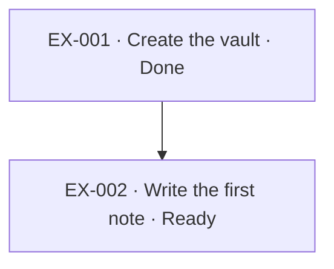

# Example Project

## Outcome

Show the smallest complete knowledgebase: one project, its tasks, the decision behind
them, and the continuity records that let another session resume.

## Scope

Deliberately tiny. Every object here is disposable — replace this note with a real
project and delete the rest.

## Success criteria

- Every core object type appears at least once with valid frontmatter.
- The task index and dependency graph below are generated by the helper, not hand-written.

## Current state

Two tasks. `EX-001` is done; `EX-002` is ready and blocked by nothing.

## Tasks
- [ ] [[Write the first note]] — Ready
- [x] [[Create the vault]] — Done

## Task dependency and progress
Task frontmatter is authoritative; this diagram is derived from `blocked_by` (or its `depends_on` alias).

## Decisions

- [[Adopt a Tolaria vault]]

## Current checkpoint

- [[2026-01-01-0900-example-project]]
