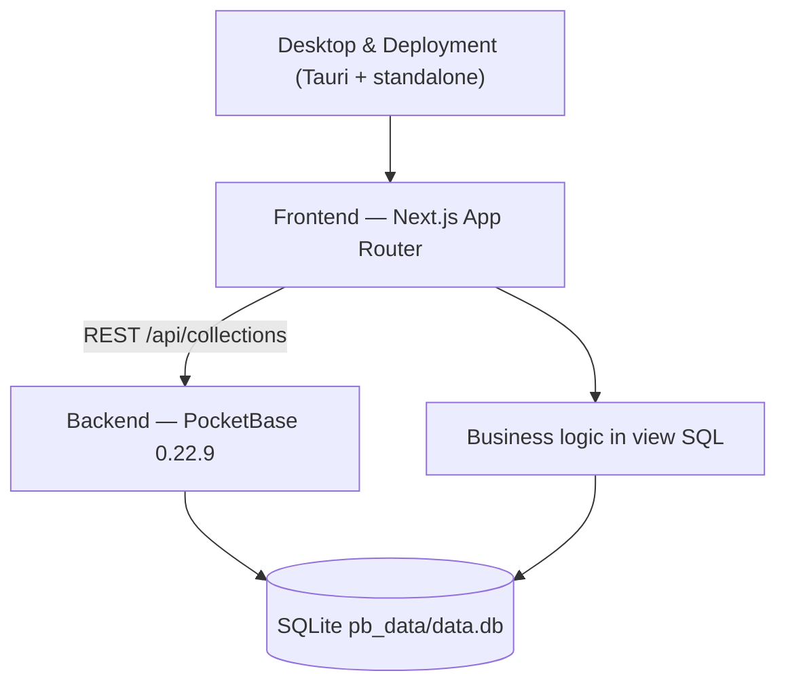
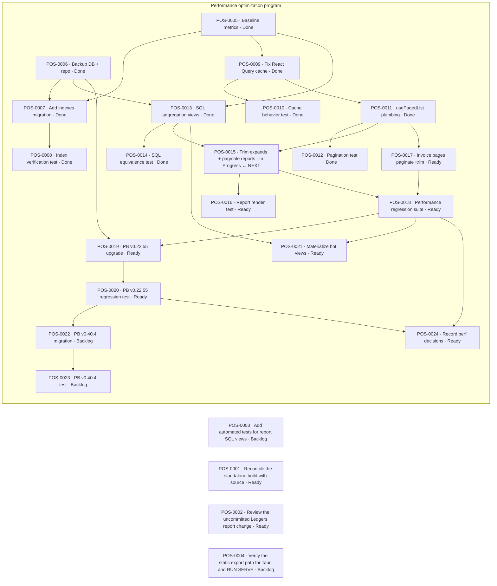

# AA Point of Sale

## Outcome

Maintain and extend **AA Point of Sale**, an offline-first point-of-sale and light ERP
system for retail/distribution businesses. It records purchases, sales, and returns;
tracks items, parties (customers/suppliers), bookers, areas, and sections; records
payments and expenses; and produces sales, profit, stock, payment, ledger, and
difference reports. It runs entirely on one Windows machine with no external services.

## Scope

In scope:

- The Next.js frontend in `frontend/` (all UI, routing, and PocketBase access).
- The PocketBase backend in `backend/` (SQLite data, collections, view queries, migrations, auth).
- Desktop packaging via Tauri (`frontend/src-tauri/`) and the prebuilt server in `standalone/`.
- Windows batch launchers at the repository root and under `backend/`.

Out of scope (not implemented in this repository):

- Cloud/multi-tenant deployment, payments gateways, or third-party integrations.
- A separate application server; the frontend talks to PocketBase directly over HTTP.

## Success criteria

- An operator can install, run, and use the app end-to-end on a clean Windows machine.
- Sales, purchase, return, payment, expense, and difference flows compute correct totals and stock movement.
- Report and ledger views in PocketBase stay consistent with the frontend's expectations.
- A fresh contributor or agent can answer "how/what/where" questions from this knowledgebase without reading source.
- The knowledgebase validates cleanly: `kb.py validate vault` and `scripts/kb_check.py`.

## Current state

- Working application. Frontend builds (`.next` present) and PocketBase 0.22.9 ships with a populated database (`backend/pb_data/data.db`).
- 41 routes are compiled in the app router (dashboard, cash memo, invoices, management, reports, auth, invoice view) — see [[Route Map]].
- 11 base collections and 14 view collections are live — see [[Data Model]].
  (`payments_summary` was added 2026-09-20.)
- **Performance program in progress** — see the task list below and
  [[Checkpoint — AA Point of Sale — 2026-09-20]]. Backend data layer is optimized and
  measured (18 indexes, window-function `ledger_party`, `payments_summary` view; party
  ledger >180 s → ~4.4 s), the React Query cache is fixed and its config/behaviour verified
  (POS-0010), and the pagination helper is verified against the live API (POS-0012).
  **Deep server expands are removed** from 7 report pages (POS-0015) — names are resolved
  client-side from cached reference collections, cutting those payloads 65–75%. Remaining:
  pagination of the transactional payments list (needs summary-backed totals) and the
  PocketBase v0.22.55 upgrade. Before/after numbers: [[Performance Baseline]].
- Known drift: the untracked `standalone/` build contains report pages that the current source does not, and predates the Tauri additions — see [[Issue — Standalone Build Drift]].
- The Ledgers report change previously flagged as uncommitted is no longer in the working
  tree (it was committed in `4ac911c`) — see [[Review the uncommitted Ledgers report change]].

## Architecture at a glance

The browser/desktop UI talks directly to PocketBase's REST API; report and ledger logic
lives inside SQLite view collections, not in application code.

Text alternative: the Next.js frontend is the only client; it calls PocketBase over HTTP.
PocketBase owns the SQLite database, including the report/ledger views whose SQL this
knowledgebase documents. Tauri and the `standalone/` server host the same frontend.

## Subsystems

- [[Frontend — Next.js Application]] — UI, routing, auth guard, PocketBase client.
- [[Backend — PocketBase Data Service]] — collections, view SQL, migrations, auth.
- [[Desktop & Deployment]] — Tauri packaging and the standalone server launcher.

## References

- [[Route Map]] — every app route and what it does.
- [[Data Model]] — collections, fields, and relationships.
- [[Reports & Ledgers]] — what each report/ledger view computes and its SQL.
- [[Build & Run Scripts]] — install, run, build, and update entry points.
- [[Glossary]] — project vocabulary (booker, scheme, party, area, section, ...).
- [[Knowledgebase Guide]] — how this vault is organized and how to keep it current.

## Tasks

- [ ] [[Add automated tests for report SQL views]] — Backlog
- [ ] [[Reconcile the standalone build with source]] — Ready
- [ ] [[Review the uncommitted Ledgers report change]] — Ready
- [ ] [[Verify the static export path for Tauri and RUN SERVE]] — Backlog

### Performance optimization program (2026-09-20)

- [x] [[POS-0005 Baseline performance metrics]] — Done
- [x] [[POS-0006 Backup database and repo snapshot]] — Done
- [x] [[POS-0007 Add indexes via migration]] — Done
- [x] [[POS-0008 Index verification test]] — Done
- [x] [[POS-0009 Fix React Query cache config]] — Done
- [x] [[POS-0010 Cache behavior test]] — Done
- [x] [[POS-0011 Paginated list plumbing]] — Done
- [x] [[POS-0012 Pagination test]] — Done
- [x] [[POS-0013 SQL aggregation views]] — Done
- [x] [[POS-0014 SQL aggregation equivalence test]] — Done
- [ ] [[POS-0015 Trim expands + adopt pagination in report pages]] — In Progress (expand trim done on 7 pages; pagination pending)
- [ ] [[POS-0016 Report pages render test]] — Ready
- [ ] [[POS-0017 Invoice entry pages: paginate + trim expands]] — Ready
- [ ] [[POS-0018 Regression-test performance suite]] — Ready
- [ ] [[POS-0019 Upgrade PocketBase v0.22.9 → v0.22.55]] — Ready
- [ ] [[POS-0020 PocketBase v0.22.55 regression test]] — Ready
- [ ] [[POS-0021 Materialize hot report views into tables]] — Ready
- [ ] [[POS-0022 Upgrade PocketBase to v0.40.4]] — Backlog (deferred major migration)
- [ ] [[POS-0023 PocketBase v0.40.4 migration test]] — Backlog
- [ ] [[POS-0024 Record performance optimization decisions]] — Ready

## Task dependency and progress

Task frontmatter is authoritative; this diagram is derived from `blocked_by` (or its `depends_on` alias).

## Decisions

- [[Decision — Use PocketBase and Next.js]]
- [[Decision — Local Offline Desktop Deployment]]

## Issues

- [[Issue — Standalone Build Drift]]

## Current checkpoint

- [[Checkpoint — AA Point of Sale — 2026-09-20]] (performance plan; supersedes [[Checkpoint — AA Point of Sale — 2026-09-19]])
