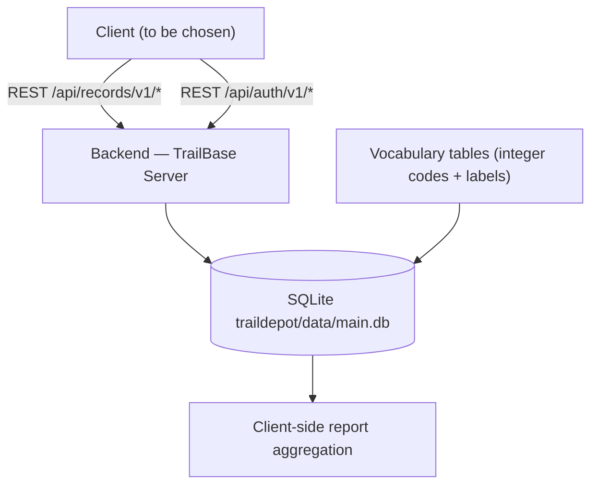
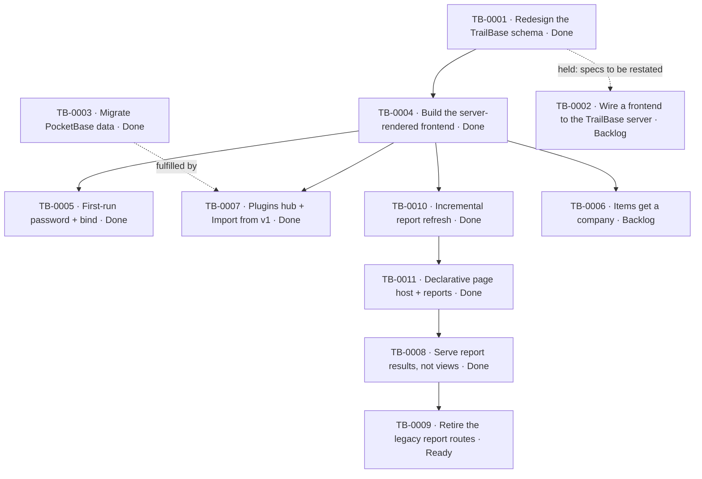

# TrailBase Backend

## Outcome

A backend for the same point-of-sale domain as [[AA Point of Sale]], built on
[TrailBase](https://trailbase.io) instead of PocketBase: a single Rust binary over SQLite that exposes
typed REST record APIs, its own auth and its own admin dashboard. It exists in `trailbase/` alongside the
PocketBase backend and does not replace it yet.

This is a **separate project, not a port**. It borrows the domain — sections, areas, categories,
companies, parties, order bookers, items, invoices, transactions, payments, expenses and their reports —
but its schema, its API shape and its operational model are deliberately different, and they are expected
to change drastically soon. The durable output so far is the measurement and decision record, not a frozen
schema.

## Scope

In scope:

- `trailbase/traildepot/` — the schema migration and the server/record-API configuration.
- TrailBase's record APIs, auth, access rules and admin dashboard as the system's interface.
- The measurements that establish which TrailBase features can carry which requirements.

Out of scope:

- The existing Next.js/PocketBase product, which stays in `frontend/` and `backend/` under
  [[AA Point of Sale]].
- Treating the current 17-table set or the four recorded decisions as final. The specs are being
  restated; expect the table list, the API surface and possibly the stack to move.

## Success criteria

- The schema is the most efficient shape SQLite allows for this workload: `STRICT` tables, integer-coded
  enumerations, no JSON columns, no views, indexes on the real access paths.
- The database is self-defining: legal enum values and their labels are rows, not a client-side map, and
  a client can discover the schema and vocabulary from the API alone.
- Every domain constraint that can be enforced in the database is enforced there, with an intelligible
  error, rather than in client code.
- The system is honest about what it cannot do: every TrailBase limitation hit is recorded with a
  reproduction instead of being worked around silently.
- A fresh session can resume from the knowledgebase — checkpoint, decisions and issues — without reading
  source.
- The knowledgebase validates cleanly: `python scripts/kb_check.py vault`.

## Current state

- Schema and API complete and verified end-to-end on `trail v0.33.15`: 17 `STRICT` tables (3 vocabulary,
  8 master data, 2 link tables, 4 transaction tables), 27 indexes (one a partial unique index on
  `barcode`), an `updated` trigger per table, 17 record APIs, no views, no JSON columns.
- Enumerations are integer codes with foreign keys into `party_types` / `invoice_types` / `payment_types`;
  codes are 0-based, so `0` means customer / purchase / sending and must never be treated as "empty".
- `traildepot/data/` is absent, so the depot is in a clean first-run state; validation happened on throw-away
  depots that were removed afterwards.
- Verified in detail under [[TB-0001 Redesign the TrailBase schema]]: migration from an empty depot, all 17
  APIs resolving, the server booting, 403 for unauthenticated requests, and the enum / link / barcode
  failure paths returning `db constraint` errors while `expand` inlines labels.
- Two TrailBase limitations shape the design and are recorded as issues:
  [[Issue — TrailBase rejects scalar JSON-schema columns]] (why enums are codes + foreign keys rather than
  declared enum schemas) and [[Issue — TrailBase view type-inference limits]] (why there are no views).
- A **server-rendered frontend** for the dashboard, reports and management now exists in
  `frontend-ssr/`: an Express app that renders MiniJinja templates from the filesystem and computes
  every report itself on worker threads, using TrailBase only for CRUD and auth. See
  [[Frontend — TrailBase Server-Rendered App]] and
  [[TB-0004 Build the server-rendered TrailBase frontend]]; `npm run smoke` passes 55/55.
- A **plugins hub** now sits in that frontend: `/plugins` lists every directory under `frontend-ssr/plugins/`
  from its `meta.md`, and each plugin page is a static file served behind the app login. A plugin is one
  folder and can be added or removed with no change to `src/` or `views/`. See
  [[TB-0007 Add the plugins hub and the Import from v1 migration plugin]].
- **The snapshot can be refreshed on demand (2026-09-26).** The top-bar state indicator is a button that
  POSTs `/reports/refresh` (probe → re-read changed tables → rebuild views → re-render reports, then
  reload); `?full=1` re-reads every table. The endpoint answers JSON or redirects back, so the control also
  works without JavaScript. See [[Issue — No manual trigger for the report snapshot refresh]] (Resolved).
- **Report generation was rebuilt around an incremental snapshot (2026-09-25).** The service no longer
  re-reads all 17 tables and rebuilds all 14 views on a TTL: a background job probes each table's fingerprint
  (row count + newest `updated`), fetches only tables that changed, rebuilds only the views they feed and
  re-renders only the reports that read one. A management write invalidates exactly the tables it touched. A
  4-colour indicator in the top bar shows the job's phase. See
  [[TB-0010 Refresh report views incrementally with a background job and an indicator]] and
  [[Decision — Refresh the report snapshot incrementally from table fingerprints]].
- **A declarative page host now exists (2026-09-25).** A page is a folder under `frontend-ssr/pages/`
  (`meta.json` + a Jinja template); Node exposes only `/p`, `/p/<slug>`, `/p/<slug>/data` and `/compute/*`,
  and holds no page-specific code. All 14 reports are migrated, and a new page was added mid-session with no
  Node change. The compute layer moved to `frontend-ssr/compute/`, which touches no Node API and is served
  verbatim to the browser. See [[TB-0011 Add the declarative page host and migrate the reports to it]] and
  [[Decision — Declarative pages: a folder is a page, the server is a generic host]].
- **The page host now requests named server-computed results rather than whole views.** The generic endpoint
  dispatches `meta.compute.report` to the existing worker-thread pool against the warm snapshot and returns
  `{filters, result}` plus select-source tables; the browser only renders. No queue, broker, cache server or
  separate service was added. **Re-measured on the live dataset 2026-09-26: the page host is now faster than
  the server-rendered route** — server-side median 270 ms → 44 ms (~6×), transferred bytes 1.13 MB → 124 KB,
  and faster end-to-end on 10/12 reports — so
  [[TB-0008 Serve report results from the page host instead of whole views]] is Done and
  [[TB-0009 Retire the legacy report routes in favour of the page host]] is unblocked. All
  14 reports are at row/total parity on live data, unfiltered, filtered and after RESET; see
  [[Issue — Declarative pages ship whole views and are slower than server rendering]] (now Resolved).
- The live dataset was re-verified as already migrated (every PocketBase row present in TrailBase). TrailBase
  holds **2 items named `elb`** that do not exist in PocketBase (209 vs 207); left in place rather than deleted.
- **The depot was wiped and re-imported on 2026-09-26** as an end-to-end test of the recent commits:
  **Import from v1** copied the live PocketBase dataset again (60,245/60,245, 0 failures), leaving a clean
  **60,254** rows / **207** items — the two extra `elb` items noted above are no longer present. All 14
  legacy reports and all 14 page-host pages were then opened in a browser and rendered, and a filter-matched
  parity sweep confirmed **14/14** reports produce identical rows and totals on both paths. See
  [[Checkpoint — Three-Server E2E Test — 2026-09-26]].
- The first plugin is **Import from v1** — a backend-free PocketBase→TrailBase migration that runs in the
  browser (both servers allow cross-origin requests) and copies the whole dataset through the record APIs.
  [[Import from v1 Plugin]], [[Decision — Run the PocketBase migration client-side as a plugin]]. It was
  verified on the live `backend/p_data` data: **60,245 / 60,245 rows, 0 failures**, with every counter and
  enum distribution matching the source and the Stock Report matching the `items_report` view exactly.
  This fulfils [[TB-0003 Migrate PocketBase data into the TrailBase schema]].
- Building that plugin exposed and fixed a latent client defect: TrailBase answers `DELETE` with a
  `text/plain` body, which the record client parsed as JSON — breaking every hard delete in the app —
  [[Issue — TrailBase returns a plain-text DELETE body]].
- One loose end from a browser-only import: it cannot invalidate the app's server-side report cache, so the
  dashboard/reports can lag by up to `CACHE_TTL_SECONDS` after a copy —
  [[Issue — Report cache lag after a client-side import]].
- **Domain clarified 2026-09-25:** `items.category` and `companies` are different things. `category` is
  vestigial (kept for later use) and `company` takes over everything the old system used `category` for
  — [[Decision — Company replaces category in the TrailBase model]]. Nothing yet links an item to a
  company, so the client still reads `items.category`; [[TB-0006 Give items a company and use it in reports]]
  covers the gap.
- First run is now correct: `trailbase/RUN.BAT` creates a fresh depot with the CLI (known admin
  password, no init race) and binds `127.0.0.1:4000` explicitly. TrailBase's IPv6-only default bind is
  recorded as [[Issue — TrailBase binds IPv6 loopback by default]] — it had made the dashboard URL and
  the frontend's `TRAILBASE_URL` both unreachable.
- The earlier React/Vite TrailBase scaffold remains deleted from the working tree (and present in git
  history) as `frontend-tb/`; it targets the *older* schema (`products`, `companies2parties`,
  `partiesEnumType`, `TEXT` enums) and is a structural reference only. The new app deliberately lives
  at a different path so the two never share files.

## Architecture at a glance

One TrailBase process owns a SQLite file and serves typed record APIs, its own auth and an admin
dashboard; the domain vocabulary lives in the database, and report arithmetic lives in the client.

Text alternative: a client authenticates against the TrailBase server and reads or writes base tables
through record APIs. The database holds both the data and the enumeration vocabularies, so no client-side
code→label map exists. Reports are computed by the client from indexed base tables, because the database
cannot expose the PocketBase-style report views.

## Subsystems

- [[Backend — TrailBase Server]] — depot layout, record APIs, auth, configuration, and the gotchas.
- [[Frontend — TrailBase Server-Rendered App]] — the dashboard/reports/management client, its report
  engine and its verification.

## References

- [[Data Model]] — the PocketBase model the domain (not the schema) comes from.
- [[Reports & Ledgers]] — what each report computes; the reference for re-implementing them client-side.
- [[Reports vs Pages — Implementation and Performance]] — how `/reports` and `/p` work and how they compare.
- [[TrailBase Frontend System Diagrams]] — interactive diagrams of the whole system.
- [[Glossary]] — domain vocabulary (booker, scheme, party, area, section, ...).
- [[Import from v1 Plugin]] — the bundled PocketBase→TrailBase migration.

## Decisions

- [[Decision — Encode enumerations as integer codes with vocabulary tables]]
- [[Decision — Drop SQL views; aggregate reports client-side]]
- [[Decision — Model multi-valued relations as link tables]]
- [[Decision — Keep PocketBase-compatible data shapes]]
- [[Decision — Company replaces category in the TrailBase model]]
- [[Decision — Run the PocketBase migration client-side as a plugin]]
- [[Decision — Refresh the report snapshot incrementally from table fingerprints]]
- [[Decision — Declarative pages: a folder is a page, the server is a generic host]]

## Issues

- [[Issue — TrailBase rejects scalar JSON-schema columns]]
- [[Issue — TrailBase view type-inference limits]]
- [[Issue — A stale TrailBase depot silently keeps an old schema]]
- [[Issue — TrailBase binds IPv6 loopback by default]]
- [[Issue — TrailBase returns a plain-text DELETE body]]
- [[Issue — Report cache lag after a client-side import]]
- [[Issue — Declarative pages ship whole views and are slower than server rendering]] — Resolved (2026-09-26)
- [[Issue — No manual trigger for the report snapshot refresh]] — Resolved (2026-09-26)
- [[Issue — Legacy report routes ignore their declared date defaults]]

## Tasks

- [x] [[TB-0001 Redesign the TrailBase schema]] — Done
- [x] [[TB-0004 Build the server-rendered TrailBase frontend]] — Done (55/55 smoke checks)
- [x] [[TB-0005 Fix the first-run admin password and the backend bind]] — Done (9/9 + browser-verified)
- [x] [[TB-0003 Migrate PocketBase data into the TrailBase schema]] — Done (60,245/60,245 rows via the plugin)
- [x] [[TB-0007 Add the plugins hub and the Import from v1 migration plugin]] — Done (real-data import verified in Chrome)
- [x] [[TB-0010 Refresh report views incrementally with a background job and an indicator]] — Done (18/18 + 7/7 harnesses)
- [x] [[TB-0011 Add the declarative page host and migrate the reports to it]] — Done (14 pages; a new page needed no Node change)
- [x] [[TB-0008 Serve report results from the page host instead of whole views]] — Done (14/14 parity; server 270→44 ms; smoke 59/59)
- [ ] [[TB-0009 Retire the legacy report routes in favour of the page host]] — Ready (blocker cleared)
- [ ] [[TB-0006 Give items a company and use it in reports]] — Backlog (held: needs the item→company link confirmed)
- [ ] [[TB-0002 Wire a frontend to the TrailBase server]] — Backlog (held pending re-specification)

## Task dependency and progress

Task frontmatter is authoritative. The page-host chain is now resolved: TB-0011 delivered the host, TB-0008
(serving results instead of views) is Done, and TB-0009 (retiring the old routes) is Ready now that its
`blocked_by` is closed. TB-0006 and TB-0002 stay held because the system's specs are being restated.

Text alternative: the schema redesign (TB-0001) underpins the server-rendered frontend (TB-0004); its
first-run/bind defects were fixed (TB-0005) and the PocketBase-data migration (TB-0003) was delivered as the
Import from v1 plugin inside a new hub (TB-0007). Report generation was then made incremental (TB-0010) and a
declarative page host with all 14 reports followed (TB-0011). The defect it left behind — **TB-0008**, the page
host shipping whole views and being slower than server rendering — is now **Done**: it serves named
server-computed results, is at row/total parity with the legacy routes on live data, and benchmarks faster
server-side and end-to-end. That unblocks **TB-0009**, retiring the legacy `/reports/*` routes, which is now
Ready. The item→company follow-on (TB-0006) and the Next.js client (TB-0002) are both held pending
specification.

## Current checkpoint

- [[Checkpoint — Manual Snapshot Refresh Control — 2026-09-26]] (supersedes
  [[Checkpoint — TB-0008 Benchmarked and Closed — 2026-09-26]], which superseded
  [[Checkpoint — Three-Server E2E Test — 2026-09-26]], which superseded
  [[Checkpoint — Portable Page-Host Compute — 2026-09-25]], which superseded
  [[Checkpoint — Page Host and Report Performance — 2026-09-25]], which superseded
  [[Checkpoint — Plugins Hub — 2026-09-25]], which superseded
  [[Checkpoint — TrailBase First Run — 2026-09-25]], which superseded
  [[Checkpoint — TrailBase Frontend — 2026-09-24]])
