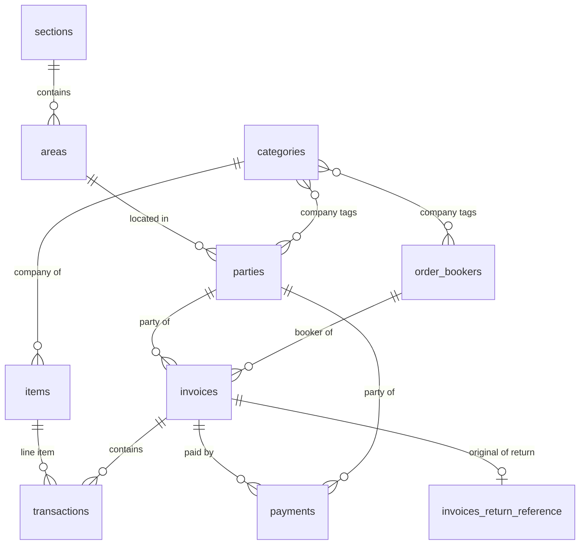

# Data Model

PocketBase schema as read from the live database (`backend/pb_data/data.db`,
`_collections`). Field lists exclude PocketBase system fields (`id`, `created`,
`updated`, `collectionId`, `collectionName`, `expand`). Versions: PocketBase 0.22.9.

## Base collections (writable)

### sections — id `nlwqqfyu1ur5lpo`
- `name` text

### areas — id `tdeikttss6upezc`
- `name` text
- `section` relation → `sections` (max 1)
- `deleted` bool

### categories — id `106aq516rbyoq0q`
- `name` text
- `deleted` bool

Used as the **company/category** of an item and as a multi-value tag on parties and
order bookers, and surfaced as `company` throughout report views.

### items — id `t063jextuf7c6he`
- `name` text
- `category` relation → `categories` (max 1)
- `cost_price` number
- `sale_price` number
- `box_size_qty` number (carton size)

### parties — id `qhdujcbptsh2v29`
- `name` text
- `type` select in {`supplier`|`customer`} (max 1)
- `phone` text
- `address` text
- `area` relation → `areas` (max 1)
- `company` relation → `categories` (max many)
- `deleted` bool

UI forms also expose a `both` option for filtering, but the stored vocabulary is
`supplier`/`customer`.

### order_bookers — id `3dz9ii2wo8d5q8g`
- `name` text
- `phone` text
- `company` relation → `categories` (max many)
- `deleted` bool

### expenses — id `72cq7pys91u4c13`
- `name` text
- `description` text
- `amount` number
- `date` date

Feeds the cash column of [[Reports & Ledgers|the general ledger]].

### invoices — id `0pwj3vph7ag7nc2`
- `type` select in {`purchase`|`sale`|`return`|`difference`} (max 1)
- `invoiceNo` number
- `booker` relation → `order_bookers` (max 1)
- `party` relation → `parties` (max 1)
- `invoice_maker` relation → `users` (max 1)
- `discount_1` number (percent)
- `discount_2` number (percent)
- `discount_rs` number (flat amount)
- `description` text
- `duedate` date
- `dated` date
- `completed` bool
- `deleted` bool

### invoices_return_reference — id `59aj32jofufhcby`
- `original_invoices` relation → `invoices` (max 1)

Links a return invoice/payment to the invoice it reverses; joined into
`payments_view` as `original_invoices`.

### transactions — id `h8ducv09yl30a7m`
- `invoice` relation → `invoices` (max 1)
- `item` relation → `items` (max 1)
- `cost_price` number
- `price` number
- `qty` number
- `scheme` number (free/extra units)
- `discount_1` number (percent)
- `discount_2` number (percent)
- `discount_rs` number (flat)
- `deleted` bool

One row per invoice line item.

### payments — id `px1b1xx26o06obx`
- `invoice` relation → `invoices` (max 1)
- `type` select in {`sending`|`recieving`|`return`} (max 1)
- `party` relation → `parties` (max 1)
- `amount` number
- `description` text
- `paid` bool
- `payment_date` date
- `paid_to` relation → `order_bookers` (max 1)

### users — auth collection (id `_pb_users_auth_`)
- `name` text, `avatar` file. Standard PocketBase email/password auth.

## Relationships

Text alternative: sections contain areas; areas contain parties; categories tag items,
parties, and bookers; invoices contain transactions (each referencing an item); invoices
and parties both relate to payments; `invoices_return_reference` connects a return to its
original invoice.

## View collections (read-only)

| View | Purpose | See |
|---|---|---|
| `invoice_view` | Per-invoice totals after item and invoice discounts. | [[Reports & Ledgers]] |
| `transaction_view` | Per-line totals, net amount, and cost. | [[Reports & Ledgers]] |
| `transactions_report` | Line detail enriched with booker/company and final amount. | [[Reports & Ledgers]] |
| `items_report` | Running item quantity (purchase/sale/return/difference). | [[Reports & Ledgers]] |
| `items_difference_report` | Quantity from `difference` invoices only. | [[Reports & Ledgers]] |
| `payments_view` | Payments joined to invoice/party/area/section/booker. | [[Reports & Ledgers]] |
| `payments_invoices_report` | Payments split across item companies by ratio. | [[Reports & Ledgers]] |
| `ledger_booker` | Credit/debit lines per payment. | [[Reports & Ledgers]] |
| `ledger_party` | Credit/debit plus running balance per party. | [[Reports & Ledgers]] |
| `ledger_area` | Ledger aggregated per party with balances. | [[Reports & Ledgers]] |
| `ledger_journal` | Double-entry journal (receivable/payable/cash/stock). | [[Reports & Ledgers]] |
| `net_price` | Per-transaction net unit price after all discounts. | [[Reports & Ledgers]] |
| `counts_for_row_numbers` | Dashboard counters for the landing page. | [[Reports & Ledgers]] |

## Conventions and gotchas

- Select value `recieving` is misspelled throughout (payment receipt). Match it exactly.
- Many computed view fields are typed `json` because they come from `printf("%.2f", ...)`
  string formatting; treat them as decimal strings, not numbers.
- `parties.type` stores only `supplier`/`customer`, but the UI offers `both` for filtering.
- `categories` doubles as "company" everywhere in reports.
- Soft deletes exist on several collections via `deleted` bool; views do not always filter
  it, so consumers must.

## Related

- Report/ledger SQL semantics: [[Reports & Ledgers]].
- Migration history and engine: [[Backend — PocketBase Data Service]].
